# Awesome-Hybrid-Cloud-Infrastructure-Backup ☁️💾

<p align="center">
  
</p>

<p align="center">
  <a href="https://github.com/ishandutta2007/Awesome-Awesome-Awesome"></a>
  <a href="https://discord.gg/jc4xtF58Ve"></a>
  <a href="https://github.com/ishandutta2007/Awesome-Hybrid-Cloud-Infrastructure-Backup/stargazers"></a>
  <a href="https://github.com/ishandutta2007/Awesome-Hybrid-Cloud-Infrastructure-Backup/network/members"></a>
  <a href="https://github.com/ishandutta2007/Awesome-Hybrid-Cloud-Infrastructure-Backup/blob/main/LICENSE"></a>
  <a href="https://github.com/ishandutta2007/Awesome-Hybrid-Cloud-Infrastructure-Backup/pulls"></a>
  <a href="https://github.com/ishandutta2007"></a>
</p>

---

## 📖 Introduction & Overview

> **Curated List of Enterprise SaaS Platforms & Modern Open-Source Hybrid Cloud Backup Engines**  
> *Focused on Hybrid Cloud Backup, On-Premises to Cloud Data Protection, Virtualized Infrastructure Backup, Kubernetes Data Resilience, and Multi-Cloud Disaster Recovery.*

**Last updated:** November 2026 📅

This repository tracks notable **SaaS / commercial platforms** and **open-source projects** for **Hybrid Cloud Infrastructure Backup**. These solutions protect physical, virtual (VMware, Hyper-V, KVM, Proxmox), containerized (Kubernetes, OpenShift), and cloud workloads by orchestrating on-premises primary backup copies with public and private cloud storage targets for immutable retention, ransomware air-gapping, disaster recovery, and long-term compliance storage.

---

## 📑 Table of Contents

- [📊 Sector Overview & Market Dynamics](#-sector-overview--market-dynamics)
- [🏢 SaaS/Hosted Platforms](#-saashosted-platforms)
- [🔓 Open-Source GitHub Projects](#-open-source-github-projects)
  - [Architectural Frameworks & Best Practices](#-architectural-frameworks--best-practices)
- [📈 Star History](#-star-history)
- [🤝 Support & Sponsorship](#-support--sponsorship)
- [🛠️ How to Contribute](#️-how-to-contribute)
- [⚖️ Disclaimer](#️-disclaimer)

---

## 📊 Sector Overview & Market Dynamics

The global cloud backup and disaster recovery solutions market is estimated at approximately **$17B–$23B** (projected to reach over **$200B by the early 2030s** with a CAGR exceeding **25%**), underpinned by hybrid architectures across over **70% of enterprise environments**. 

The market exhibits **moderate fragmentation**: while hyperscalers (Microsoft, AWS) and consolidated cybersecurity/data resilience giants (Veeam, Cohesity/Veritas, Rubrik, Commvault) capture the lion's share of enterprise budgets, specialized MSP appliances and pure-play disaster recovery vendors maintain robust defensible footholds.

---

## 🏢 SaaS/Hosted Platforms

| Platform | Organization Scale (Valuation / Revenue) | Description | Pricing (Starting Tier) | Free Tier Limits / Free Trial |
| :--- | :--- | :--- | :--- | :--- |
| **[Microsoft Azure Backup Server / MABS](https://azure.microsoft.com/en-us/products/backup/)** | ~$3.1T Market Cap / ~$245B+ Annual Rev (Parent: Microsoft) | On-premises backup server that integrates with Azure for hybrid backup, long-term retention, and cloud-based recovery. | Free software download; protected instance fees start at ~$10/instance/month (under 500 GB) + Azure storage (LRS starts at ~$0.0224/GB-month) | 30-day trial with $200 Azure cloud credits for new Azure accounts |
| **[AWS Storage Gateway](https://aws.amazon.com/storagegateway/)** | ~$2.2T Market Cap / ~$107B+ AWS ARR (Parent: Amazon) | Hybrid cloud storage service that connects on-premises environments with AWS storage for backup, archiving, and disaster recovery use cases. | $0.00/hour gateway fee for S3/Tape/Volume ($0.69/hour for FSx); data written to AWS starts at $0.01/GB (capped at $125/gateway/mo) + S3 storage | First 100 GB written to AWS per account free (one-time introductory allowance) |
| **[Rubrik Cloud Cluster / Hybrid](https://www.rubrik.com/)** | ~$11.3B Market Cap (NYSE: RBRK) / ~$887M Annual Rev | Data management platform that extends Rubrik’s policy-driven protection and recovery capabilities into hybrid and multi-cloud environments. | Enterprise subscriptions starting at ~$50,000/year (~$1,000–$1,500/TB/year depending on BETB/FETB capacity commitment) | Scoped POC only; hosted M365 trial limited to 500 users / 10 TB, Google Workspace trial limited to 10 users / 500 GB |
| **[Veeam Cloud Connect](https://www.veeam.com/)** | $15.0B Valuation (Dec 2024 secondary) / $1.7B+ ARR | Enables service providers and enterprises to deliver or consume off-site backup and disaster recovery as a service while keeping primary backup infrastructure on-premises. | Cloud repository storage starts at ~$20–$25/TB/month via VCSP partners (or ~$3–$4/VM/month) | 30-day free trial through VCSP partners, typically capped between 250 GB and 5 TB cloud storage |
| **[Cohesity DataProtect Hybrid](https://www.cohesity.com/)** | $7.0B–$8.0B Valuation (post-Veritas merger) / $1.7B+ Pro Forma Rev | Unified data protection solution that spans on-premises infrastructure and public cloud targets with global deduplication and simplified management. | BaaS/DPaaS starts at ~$29,100/year (AWS Marketplace baseline package); capacity licensing starts at ~$1,000–$1,500/FETB/year | 30-day free trial of Backup-as-a-Service / DPaaS environment |
| **[Commvault Hybrid Cloud](https://www.commvault.com/)** | ~$6.5B Market Cap (NASDAQ: CVLT) / ~$995M Annual Rev | Comprehensive data management platform supporting hybrid environments with backup, recovery, and data mobility across on-premises and multiple clouds. | Commvault Cloud SaaS starts at $58.50/TB/month (or $1.70/user/month for M365); self-managed starts at $98/VM/year or $150/FETB/year | 30-day free trial (or 30,000 trial credits via cloud marketplace) |
| **[Datto SIRIS Hybrid](https://www.datto.com/)** | $6.2B Acquisition Valuation (Parent: Kaseya) / ~$620M Annual Rev | Business continuity and disaster recovery appliances/solutions designed for hybrid on-premises + cloud recovery scenarios. | Hardware/virtual deployments start at ~$300–$500/month (appliance hardware from ~$995 upfront or zero-cost hardware on 36-month terms) | No self-service free trial; interactive sandbox demo and scoped MSP proof-of-concept upon request |
| **[Quest NetVault](https://www.quest.com/)** | $5.4B Acquisition Valuation (Clearlake Capital) / ~$1.0B+ Rev | Cross-platform backup and recovery solution supporting heterogeneous environments and hybrid cloud targets. | Component/entry licenses start at ~$1,000/year; capacity-based enterprise pricing quotes per TB | 30-day full-featured evaluation license with 30-day trial technical support |
| **[Acronis Cyber Protect Hybrid](https://www.acronis.com/)** | ~$4.0B Valuation (EQT acquisition) / ~40% Cloud ARR Growth | Integrated cyber protection suite combining backup, recovery, and security for hybrid physical, virtual, and cloud workloads. | Workstation licenses start at $85.00/workstation/year; server protection starts at $499.00/server/year (or MSP per-GB/workload consumption) | 30-day free trial with full access to backup, recovery, and cybersecurity features |
| **[Druva Hybrid Cloud Backup](https://www.druva.com/)** | $2.0B Valuation (Series H) / $200M+ SaaS ARR | Cloud-native data protection platform with hybrid capabilities for endpoints, servers, and workloads, offering centralized management and cloud storage. | Hybrid server workloads start at ~$210–$250/TB/month (post-deduplication); SaaS/M365 modules start at ~$8/user/month | 30-day free trial (self-service evaluation across hybrid server & SaaS workloads) |
| **[Zerto Hybrid Cloud](https://www.zerto.com/)** | $374M Acquisition Price (Parent: HPE) / ~$100M+ Rev | Continuous data protection and disaster recovery platform focused on virtualized and hybrid cloud environments with near-zero RPOs. | Enterprise Cloud Edition (ECE) starts at ~$1,400–$2,200/VM/year (volume tiers scale down to $400–$800/VM/year) | 14-day software trial (or 30-day in-cloud marketplace trial), capped at protecting up to 10–15 VMs |

---

## 🔓 Open-Source GitHub Projects

Commercial hybrid backup platforms lead in turn-key enterprise support, but open-source solutions provide unmatched sovereignty, auditability, and zero per-workload software licensing fees.

*Ranked in descending order by GitHub_Stars:* 🌟

1. **[Rclone](https://github.com/rclone/rclone)** [](https://github.com/rclone/rclone/stargazers) 🌐  
   *The Swiss Army knife of cloud storage.* Multi-threaded command-line program to sync and transfer files and directories to and from over 70 cloud object stores, including S3, B2, Azure Blob, Google Cloud Storage, SFTP, and WebDAV. Serves as a vital transport layer for hybrid backup automation.

2. **[Restic](https://github.com/restic/restic)** [](https://github.com/restic/restic/stargazers) ⚡  
   *Secure, fast, and lightweight backup program.* Written in Go with built-in cryptography and content-defined deduplication. Works natively with local disks, SFTP, and cloud storage targets (AWS S3, MinIO, Azure Blob, Google Cloud Storage, Backblaze B2).

3. **[Duplicati](https://github.com/duplicati/duplicati)** [](https://github.com/duplicati/duplicati/stargazers) 🖥️  
   *Free client-side encrypted backup software with a built-in web management interface.* Features AES-256 encryption, incremental backups, deduplication, and integration with S3, OneDrive, Google Drive, and generic cloud targets for hybrid server and endpoint protection.

4. **[Kopia](https://github.com/kopia/kopia)** [](https://github.com/kopia/kopia/stargazers) 🚀  
   *Fast and secure open-source backup tool.* Features client-side end-to-end encryption, compression, and deduplication with native multi-cloud object storage connectivity (S3, B2, GCS, Azure Blob) and both CLI and desktop/web GUI interfaces.

5. **[BorgBackup](https://github.com/borgbackup/borg)** [](https://github.com/borgbackup/borg/stargazers) 🛡️  
   *Deduplicating archiver with compression and authenticated encryption.* Industry-standard tool for efficient server infrastructure backups over SSH, supporting append-only repositories for ransomware protection.

6. **[Velero](https://github.com/velero-io/velero)** [](https://github.com/velero-io/velero/stargazers) ☸️  
   *Cloud-native disaster recovery for Kubernetes workloads.* Backs up and restores Kubernetes cluster resources and persistent volumes across on-premises clusters and public cloud infrastructure (AWS, Azure, GCP).

7. **[Longhorn](https://github.com/longhorn/longhorn)** [](https://github.com/longhorn/longhorn/stargazers) 💾  
   *Cloud-native distributed block storage built for Kubernetes.* Provides enterprise snapshotting, volume replication, and recurring automated backup synchronization directly to remote S3 or NFS targets.

8. **[Bup](https://github.com/bup/bup)** [](https://github.com/bup/bup/stargazers) 📦  
   *Highly efficient backup system based on the Git packfile format.* Provides rolling-checksum deduplication capable of backing up large raw disk images and multi-terabyte virtual machine files over the network.

9. **[Duplicacy](https://github.com/gilbertchen/duplicacy)** [](https://github.com/gilbertchen/duplicacy/stargazers) 🔗  
   *Lock-free deduplication backup engine.* Allows multiple clients to back up simultaneously to the same remote cloud or on-premises storage without coordination or locks, featuring client-side encryption.

10. **[Borgmatic](https://github.com/witten/borgmatic)** [](https://github.com/witten/borgmatic/stargazers) ⚙️  
    *Simple, configuration-driven backup software for BorgBackup.* Automates database dumps (PostgreSQL, MySQL, SQLite, MongoDB), validates backup integrity, and dispatches monitoring alerts to healthcheck services.

11. **[Autorestic](https://github.com/cupcakearmy/autorestic)** [](https://github.com/cupcakearmy/autorestic/stargazers) 🤖  
    *Config-driven CLI wrapper for Restic.* Simplifies backup orchestration across multiple locations, servers, and cloud backends using concise YAML configuration files.

12. **[Bareos](https://github.com/bareos/bareos)** [](https://github.com/bareos/bareos/stargazers) 🏢  
    *Enterprise-grade network backup system (AGPLv3).* Fork of Bacula offering centralized Director, Storage Daemon, and cross-platform File Daemon agents. Seamlessly integrates on-prem disk/tape with S3-compatible cloud object storage.

13. **[UrBackup](https://github.com/uroni/urbackup_backend)** [](https://github.com/uroni/urbackup_backend/stargazers) 🖥️  
    *Client/server backup system for mixed Windows and Linux environments.* Performs both file-level and live disk-image backups with a centralized web console and offsite Internet backup client functionality.

14. **[Kanister](https://github.com/kanisterio/kanister)** [](https://github.com/kanisterio/kanister/stargazers) ☸️  
    *Application-level data management framework for Kubernetes.* Enables application-consistent backup, restore, and mobility across hybrid Kubernetes environments using customizable operational blueprints.

15. **[Burp](https://github.com/grke/burp)** [](https://github.com/grke/burp/stargazers) 🔒  
    *Network backup and restore program.* Uses librsync to generate delta diffs and network-efficient snapshots over SSL across heterogeneous servers and storage endpoints.

16. **[Amanda](https://github.com/zmanda/amanda)** [](https://github.com/zmanda/amanda/stargazers) 📜  
    *Advanced Maryland Automatic Network Disk Archiver.* Battle-tested open-source network backup solution that coordinates backups from multiple client machines to a master server connected to tape drives, disks, or cloud storage.

17. **[Proxmox Backup Server](https://github.com/proxmox/proxmox-backup)** [](https://github.com/proxmox/proxmox-backup/stargazers) 🖧  
    *Enterprise backup solution for Proxmox VE virtual machines, containers, and physical hosts.* Features client-side encryption, Zstandard compression, and chunk-based deduplication for local and remote hybrid sync targets.

---

### 🧩 Architectural Frameworks & Best Practices

```text
       [ Physical Servers / Bare-Metal / Databases ]   [ Kubernetes & VMs ]
                                    │                           │
                   ┌────────────────┴───────────────────────────┴────────────────┐
                   ▼                                                             ▼
         Orchestration Layer                                           Engine & Transport
     (Bareos / Bacula / Borgmatic)                                   (Restic / Kopia / Rclone)
                   │                                                             │
                   ▼                                                             ▼
     Primary On-Premises Backup Pool                               Remote Hybrid Cloud Vault
       (Fast RTO / Deduplicated NAS)     ──────── Replicate ──────▶   (S3 / Glacier / Immutable)
```

- **Enterprise Client/Server Backups:** Deploy **Bareos**, **Bacula**, or **UrBackup** as the central director and storage scheduler.
- **Modern Encrypted Snapshot Engines:** Utilize **Restic**, **BorgBackup**, or **Kopia** for client-side encrypted, block-level deduplicated backups.
- **Container & Kubernetes Workloads:** Implement **Velero**, **Longhorn**, or **Kanister** for stateful persistent volumes and custom application blueprints.
- **Hybrid Cloud Transport & Tiering:** Leverage **Rclone** for multi-cloud synchronizations and tiering from fast on-premises NVMe/disk caches to cold cloud object storage.

---

## 📈 Star History

[](https://www.star-history.com/#ishandutta2007/Awesome-Hybrid-Cloud-Infrastructure-Backup&type=date&legend=top-left)

---

## 🤝 Support & Sponsorship

Thank you for visiting and using **Awesome-Hybrid-Cloud-Infrastructure-Backup**! ❤️

If this curated repository has assisted you in designing, evaluating, or securing your hybrid cloud backup and disaster recovery architecture, please consider:
- 🌟 **Starring** the repository on GitHub
- 🍴 **Forking** and contributing new tools, fixes, or documentation
- 📢 **Sharing** with your DevOps, SRE, and infrastructure engineering peers

☕ If you would like to support ongoing maintenance and research, you can buy a coffee or sponsor this project at the **[GitHub Sponsors Dashboard](https://github.com/sponsors/ishandutta2007)**.

---

## 🛠️ How to Contribute

Contributions are welcome and appreciated!

1. 🍴 Fork the repository.
2. 🌿 Create a feature branch (`git checkout -b feature/new-backup-tool`).
3. 📝 Add or update entries in `README.md` (keep descriptions factual, objective, and adhere to formatting).
4. 🚀 Submit a Pull Request with a clear description of the project.

---

## ⚖️ Disclaimer

- This is an **independent, community-curated collection** — inclusion does not constitute a commercial endorsement.
- Backup, disaster recovery, and compliance policies are mission-critical. Always conduct thorough restore verification drills, benchmark RPO/RTO metrics, and validate encryption key escrow procedures before relying on any solution in production.

---

<p align="center">
  <b>Built for Infrastructure Engineers, SREs, Systems Administrators, and Cloud Architects.</b><br>
  <i>Keep your hybrid infrastructure resilient, immutable, and under your control.</i>
</p>
